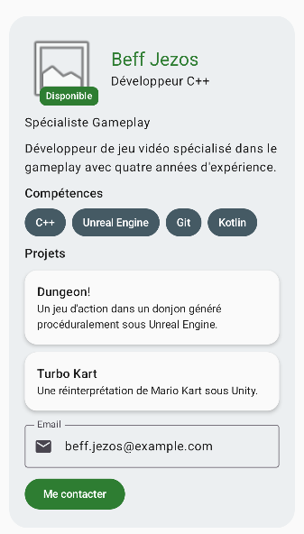

Duncan Hamelin ESGI – M1 IW (2026-2027)

1. Profil développeur – V2

2. J'ai amélioré ma mini-application jetpack compose qui affiche le profil d'un développeur. Il y a maintenant
   le nom, le métier, la spécialité, une description, une image de profil avec un badge de disponibilité,
   une liste de compétences, une liste de projets, un encart pour le mail et un bouton "me contacter" qui écrit une phrase
   dans le terminal ("Bonjour, je suis NomDuDéveloppeur"). Il y a aussi deux previews qui montrent un développeur jeu vidéo en thème clair et un golang en thème sombre.

3. Les composants :
   - Text
   - Button
   - Icon
   - Image
   - Card
   - OutlinedTextField en lecture seule
   - Surface

4. Les layouts :
   - Column
   - Row
   - Box
   - Spacer
   - Surface
   - LazyColumn
   - LazyRow

5.
L'écran est une LazyColumn. Les blocs uniques sont placés dans des item, les projets sont placés dans items(projets) avec une clé id.
chaque projet est affiché avec le composable CardProjet. Les compétences sont dans une LazyRow (ListeCompetences)
qui affiche un Competence pour chaque badge de compétence. Les listes lazy n'affichent que les éléments visibles à l'écran.

6.
J'ai repris le vert du nom de la V1 comme couleur principale (primary) et j'ai remplacé le rose par du gris
pour le background et la surface, avec un bleu pour les compétences.
J'ai fait un mode clair et un mode sombre avec lightColorScheme et darkColorScheme, en fonction de isSystemInDarkTheme().
Les composables utilisent MaterialTheme.colorScheme, MaterialTheme.typography et MaterialTheme.shapes au lieu de valeurs en dur.

7.

8.
J'ai utilisé :
- Les composants fondamentaux
- Les Column, Row, Box et Spacer et Surface
- Les listes modernes avec LazyColumn et LazyRow
- Des composables réutilisables
- Material Design avec un mode clair et un mode sombre